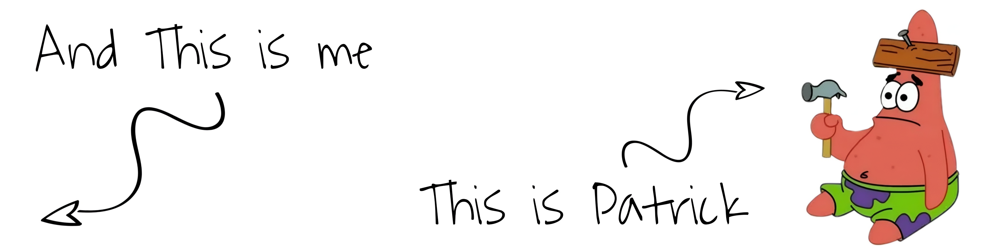
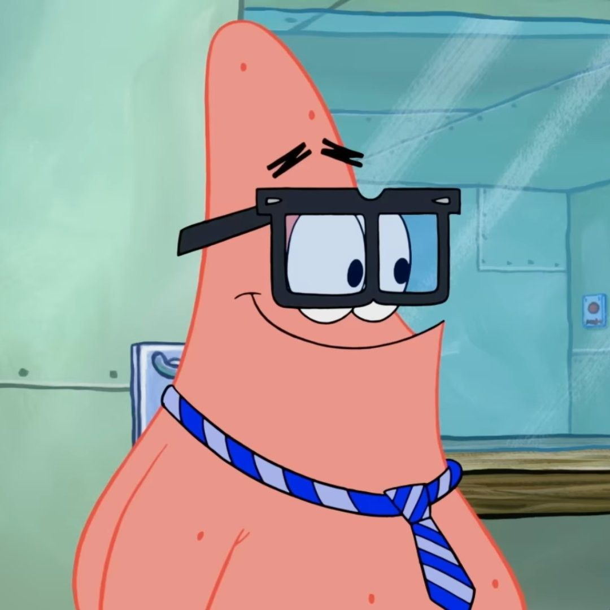
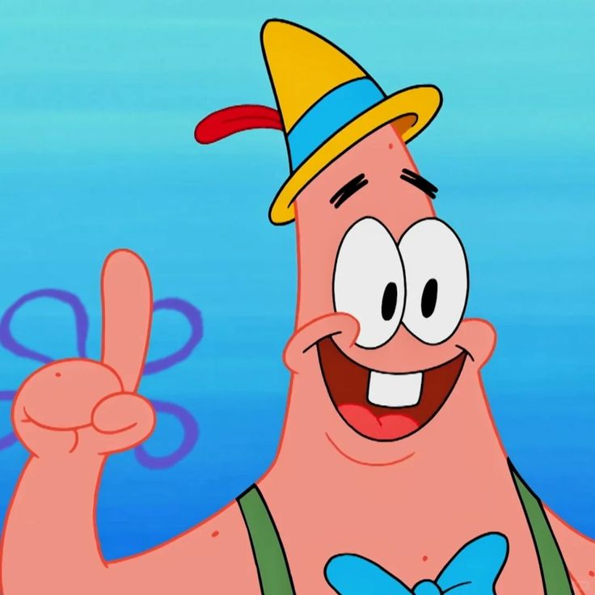

  

 

Transforming raw data into actionable intelligence and digital experiences. Currently deep-diving into Deep Learning, AI development, and creative problem solving. Created to create.

 

  
  
  

<h3 align="right">Co-founder of Custodia</h3>

Custodia is a browser-based coding platform we built for our college crew, with an in-browser editor, instant code execution and practice sets for Python, SQL, Java, C, DSA, DBMS and ML. We also take part in hackathons, with our first one coming up next week.

 

<h3>Reader, Chess Player, Writer, Roblox Game Developer</h3>

I read a lot of Russian and German literature, play chess, and write a lot. I am also the author of "Death Chanel", and my first Roblox game, "Egg Overload", is going live on Roblox in a few days.

 
